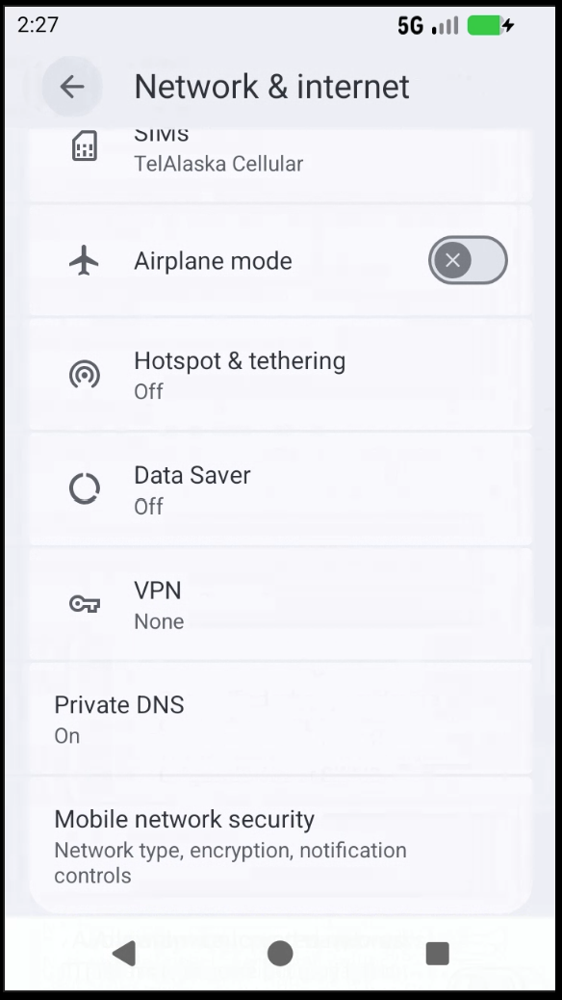
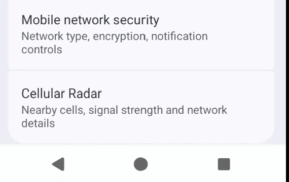
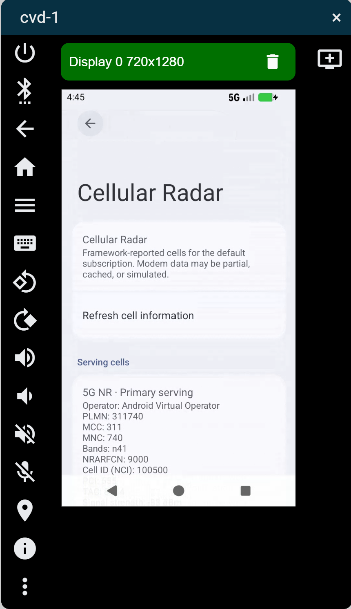
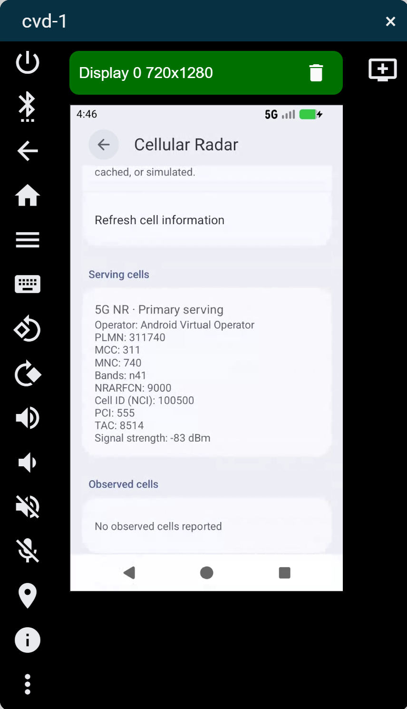

# Project #11 — Cellular Radar for AOSP

A native Android 17 Settings extension for inspecting framework-reported cellular
information. The entry lives under **Settings > Network & internet > Cellular
Radar**. This repository-sized publication package contains a patch series,
documentation, and reproduction scripts; it does not contain an Android image
or a full AOSP checkout.

The current milestone is a diagnostic preference screen. Cellular Radar presents
framework-reported cellular information; it **does not determine physical antenna
direction or distance**. The graphical radar is future work.

## Screenshots and demo

The screenshots below show the Settings navigation and Cellular Radar diagnostics.
Cuttlefish cellular values come from its simulated modem.

| Initial Settings screen | Modified Settings screen |
|---|---|
|  |  |

| Cellular Radar — identity | Cellular Radar — cell details |
|---|---|
|  |  |

See the [screenshot notes](docs/screenshots/README.md).

A local Cuttlefish observation reported the following **simulated** serving cell.
This is an example observation, not a fixed dataset, live measurement, or guarantee
of what another environment will report:

| Field | Observed value |
|---|---|
| Technology | 5G NR; NR SA reported by the radio stack |
| Operator | Android Virtual Operator |
| MCC / MNC / PLMN | 311 / 740 / 311740 |
| NR band / NRARFCN | n41 / 9000 |
| NCI / PCI / TAC | 100500 / 555 / 8514 |
| Signal strength | Approximately -83 dBm; varies |
| Observed neighbors | None reported |

NR SA here describes the observed radio-stack state; the cell screen's title is
5G NR and does not infer SA/NSA from CellInfo alone.

## Features

- Native Settings navigation and a simple diagnostic screen.
- Serving, secondary-serving, registered/camped, and observed cell classification.
- NR, LTE, WCDMA, GSM, TD-SCDMA, and CDMA/EVDO cell support.
- Operator, MCC, MNC, and derived PLMN where the cell identity exposes them.
- NR/LTE bands and channels; technology-specific cell identifiers.
- Framework-provided signal power and NR/LTE quality measurements.
- Explicit unavailable values, manual refresh, empty/error states, callback cleanup,
  and measurement age at display.

## Architecture

Acquisition, immutable data, text formatting, and preference presentation are
separate components:

`Telephony framework → CellularRadarRepository → CellularRadarCell →
CellularRadarFormatter → CellularRadarFragment → Settings UI`

See [architecture](docs/architecture.md) for the complete radio-stack flow and
component responsibilities.

## Technologies and cellular data

Java, Android TelephonyManager/TelephonyCallback/CellInfo/CellIdentity/
CellSignalStrength, AOSP Settings DashboardFragment, AndroidX preferences,
localized Android resources, Soong, Robolectric, Mockito, and Truth.

| Radio family | Exposed diagnostic data |
|---|---|
| NR | Operator, MCC/MNC/PLMN, bands, NRARFCN, NCI, PCI, TAC, signal power, SS-RSRP/RSRQ/SINR, CSI-RSRP/RSRQ/SINR |
| LTE | Operator, MCC/MNC/PLMN, bands, EARFCN, CI, PCI, TAC, signal power, RSRP, RSRQ, RSSNR |
| WCDMA / GSM / TD-SCDMA | Available operator/network codes, cell ID, LAC, PSC/BSIC/CPID as appropriate, signal power |
| CDMA / EVDO | Available operator, base-station/network/system IDs, separate CDMA and EVDO power |

PLMN is formed only from valid framework-provided MCC and MNC strings, preserving
leading zeros. Missing measurements are never fabricated.

## Build and test validation

Validated on Ubuntu 24.04 in WSL with Android 17, product
`aosp_cf_x86_64_only_phone`, release `aosp_current`, variant `userdebug`.

- `m Settings -j8`: passed.
- Focused Robolectric classes: **25 tests passed** (10 model, 6 formatter,
  9 repository).
- Resource XML and `git diff --check`: passed.

These are recorded implementation results, not a new OS rebuild during
publication preparation. See [validation](docs/validation.md) for packaging checks.

## Reproduction

Use a compatible full AOSP checkout with bootable Cuttlefish images and source-built
host tools. The patch series starts at Settings commit
`213829fb67f5e070029e0513a088f31bc8f5c1ed`.

1. Read [build and run](docs/build-and-run.md).
2. Prepare a clean Settings branch at that base and run
   [apply-patches.sh](scripts/apply-patches.sh).
3. Select the documented lunch target and build Settings.
4. Launch Cuttlefish with [launch-cuttlefish.sh](scripts/launch-cuttlefish.sh),
   deploy the APK as documented, and open the native Settings entry.

The application script uses `git am`, creating local commits only in the checkout
you deliberately supply. Package preparation did not commit anything in the
original Settings checkout. [Patch provenance](docs/provenance.json) records the
two original commits and a third export-only working-tree snapshot.

## Cuttlefish limitations

Cuttlefish uses a **simulated modem**. The tested environment reports **one serving
NR cell and no neighboring cells**. The simulator's values do not establish real
base-station geography or radio coverage.

Telephony may return empty, partial, cached, or rate-limited data. Unknown identity
and signal fields remain unavailable. Location/phone permissions and enabled
Location affect access. Data is scoped to the default subscription; a multi-SIM
selector is not implemented.

The model conservatively suppresses both maximum sentinel representations for
NCI because this checkout's default NR identity uses the integer maximum. This
also suppresses the rare legitimate NCI equal to that number.

## Future work

- Validate real-device behavior across radio technologies and modem vendors.
- Add a graphical representation of reported signal/cell data without implying
  measured physical direction or distance.
- Consider subscription selection and clearer freshness reporting.

These are future directions, not implemented features.

## License

Documentation and scripts are provided under [Apache License 2.0](LICENSE).
AOSP-derived patch content retains its original licensing headers and notices.
Original commit author metadata is preserved. This is an independent AOSP
extension, not a claim that the feature is part of upstream Android.
